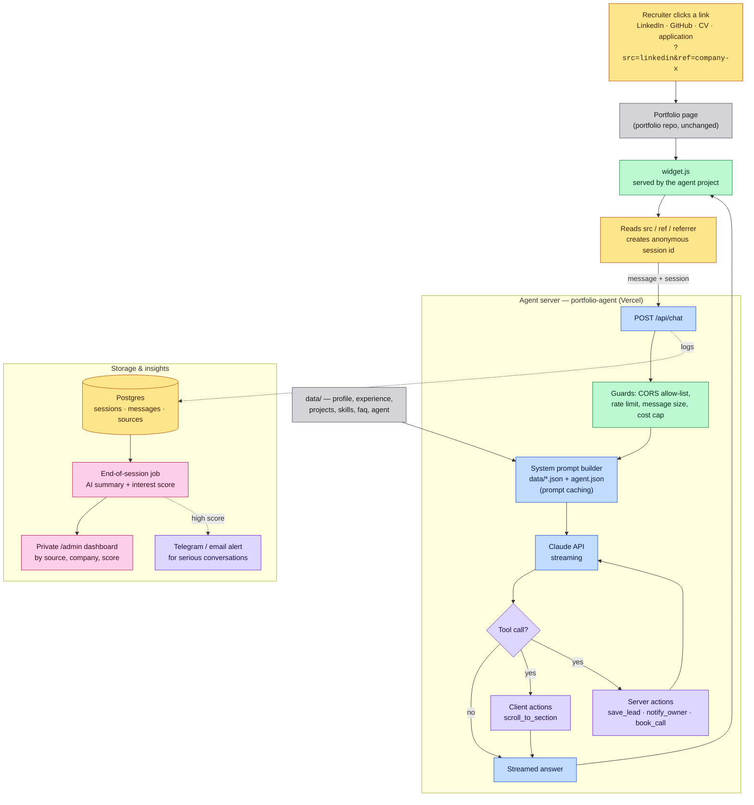
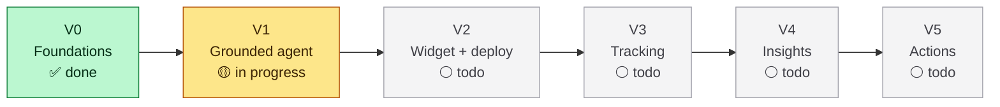

# Portfolio Agent — Roadmap

An AI agent that presents Siwar's profile to recruiters, then records who really talked to it and where they came from.

> **Isolation rule:** this repository is separate from `portfolio/`. The agent is deployed as its own Vercel project.
> The portfolio only gets **one `<script>` tag** at the very end (step V2.4). Nothing else in the portfolio changes.

_Last updated: 2026-11-16_

---

## 1. Overview of the complete flow

Colors show the version each part arrives in. Grey = already done.

| Color | Version | Theme |
|---|---|---|
| Grey | V0 | Done: knowledge base |
| Blue | V1 | The agent answers well (local) |
| Green | V2 | Widget, protection, deployment, integration |
| Yellow | V3 | Who talks, and from where |
| Pink | V4 | Summaries, scores, dashboard |
| Violet | V5 | Actions: scroll, leads, notifications |

---

## 2. Progress by version

> Update this diagram as versions move: change `:::todo` → `:::doing` → `:::done` and the emoji.

---

## 3. Step by step

### V0 — Foundations ✅
Goal: a clean, isolated project with reliable data.

- [x] **V0.1** Knowledge base in `data/` (profile, experience, projects, skills, faq)
- [x] **V0.2** Agent behaviour in `data/agent.json` (English, professional and sober, no salary figures, no grades)
- [x] **V0.3** Separate project folder `portfolio-agent/`, `data/` moved out of the portfolio
- [x] **V0.4** Khidma repositories are private for now: the agent will not share links
- [x] **V0.5** Project setup: `package.json`, TypeScript, `.env.example` (`ANTHROPIC_API_KEY`), `.gitignore`, README
- [x] **V0.5b** `src/data.ts` (typed loader + zod schemas) and `npm run check:data` (ids, cross-references, todos)
- [x] **V0.6** First commit + GitHub repository [`siwar224/portfolio-agent`](https://github.com/siwar224/portfolio-agent)

**Done when:** the project installs and type-checks with no code from the portfolio. ✅ `npm run check` passes.

### V1 — Grounded agent (local) 🟡
Goal: the agent answers recruiter questions correctly, from the terminal, before any UI.

- [x] **V1.1** `src/prompt.ts` — builds the system prompt from `data/*.json` + `agent.json`
- [x] **V1.2** `src/agent.ts` — calls Claude with streaming, prompt caching and refusal fallback
- [x] **V1.3** Local test playground: `npm run dev` → `playground/index.html` (quick tests, token/cache stats, system prompt viewer)
- [ ] **V1.3b** First real test session with an API key
- [ ] **V1.4** Job-description matching: paste a job offer, get strengths with evidence and honest gaps
- [ ] **V1.5** `evals/questions.jsonl` — 20–30 typical recruiter questions with expected facts
- [ ] **V1.6** `scripts/eval.ts` — runs the questions and checks: no invented facts, English only, no salary figure

**Done when:** the eval passes and answers feel right to Siwar.

### V2 — Widget, protection, deployment ⚪
Goal: a public, safe endpoint and a chat bubble that can be embedded anywhere.

- [ ] **V2.1** `api/chat.ts` — Vercel function streaming the answer
- [ ] **V2.2** Guards: CORS allow-list (portfolio domain only), rate limit per IP/session, max message length, daily cost cap
- [ ] **V2.3** `public/widget.js` — standalone chat bubble (vanilla JS, no dependency on the portfolio's code)
- [ ] **V2.4** Deploy as its own Vercel project, then add **one** `<script src=".../widget.js">` tag to the portfolio
- [ ] **V2.5** Privacy notice inside the widget

**Done when:** a visitor on the live portfolio can chat, and abuse is blocked.

### V3 — Tracking: who talks, and from where ⚪
Goal: know which channels and applications bring real conversations.

- [ ] **V3.1** Tagged links: `?src=linkedin`, `?src=github`, `?src=cv`, `?ref=<company>` for each application
- [ ] **V3.2** Widget sends `src`, `ref`, `document.referrer`, landing page and an anonymous session id
- [ ] **V3.3** Postgres (Neon): tables `sessions`, `messages`
- [ ] **V3.4** Engagement level per session: visit only / short (1–2 messages) / engaged (3+ or job offer pasted)
- [ ] **V3.5** Retention: data removed after 6–12 months, no raw IP stored

**Done when:** for each conversation, the source and engagement level are stored.

### V4 — Insights ⚪
Goal: read conversations in 10 seconds instead of 10 minutes.

- [ ] **V4.1** End-of-session AI summary: visitor type, company (if given), role, interests
- [ ] **V4.2** Interest score (0–100) with a one-line reason
- [ ] **V4.3** Private `/admin` dashboard: sessions by source, company, score, summary
- [ ] **V4.4** Stats per source and per application link

**Done when:** Siwar can see at a glance which channel and which application works.

### V5 — Actions ⚪
Goal: the agent does things, not only talks.

- [ ] **V5.1** `scroll_to_section` — needs ids on the project cards in the portfolio (small portfolio change, to approve then)
- [ ] **V5.2** `save_lead` — name, company, email, only with explicit consent
- [ ] **V5.3** `notify_owner` — Telegram or email alert for high-score conversations
- [ ] **V5.4** `book_call` — booking link

**Done when:** a serious recruiter can leave contact details and Siwar is notified.

---

## 4. Decisions log

| Date | Decision | Why |
|---|---|---|
| 2026-11-16 | No RAG: all data goes in the system prompt | ~14k tokens, fits easily; prompt caching keeps it cheap |
| 2026-11-16 | TypeScript + npm, zod schemas for data/ | Same language as the future Vercel function and widget; data errors caught before runtime |
| 2026-11-16 | Agent isolated from the portfolio | Independent deploys; portfolio only embeds a script |
| 2026-11-16 | Agent answers in English, professional and sober tone | Target audience: international recruiters |
| 2026-11-16 | No grades/honours, no salary figures | Siwar's choice |
| 2026-11-16 | Lead capture and notifications postponed to V5 | Focus on answer quality first |
| 2026-11-16 | TheMenuFy and Kool excluded from the data | Siwar's choice |

## 5. Open questions

- Model: `claude-opus-5-5` (best quality) or `claude-haiku-5-5` (much cheaper) for production answers? To decide after the V1 eval.
- Domain for the agent (e.g. `portfolio-agent.vercel.app` or a subdomain).
